## Nahum flores 0065

## opencv

## Imagen original
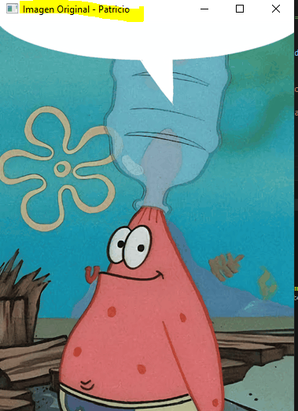

## Pixel modificado
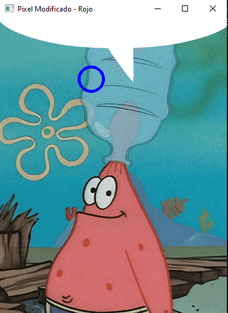

## Imagen con ROI marcada
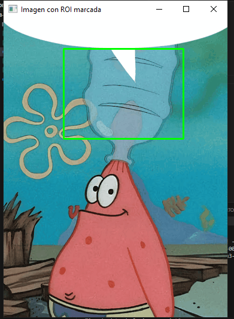

## ROI
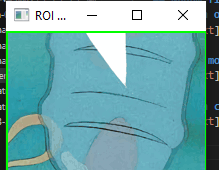

## Escala de grises
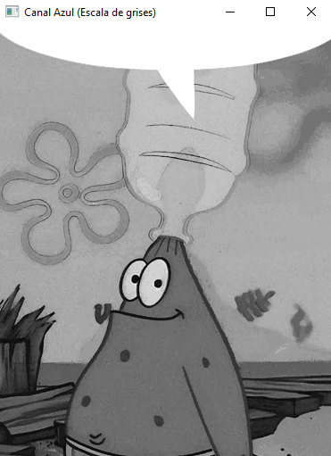
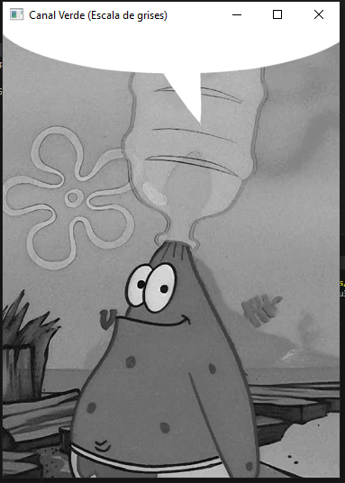
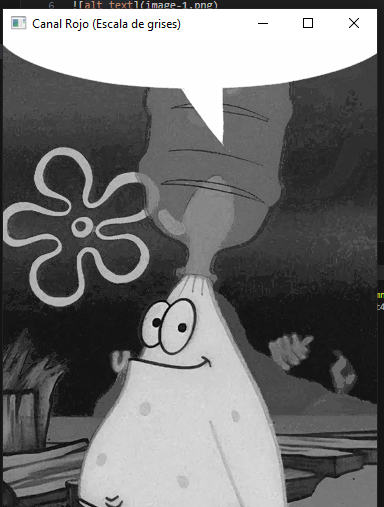

## Canales verde,azul y rojo
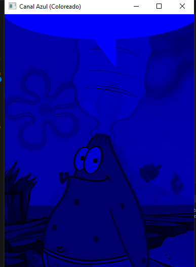
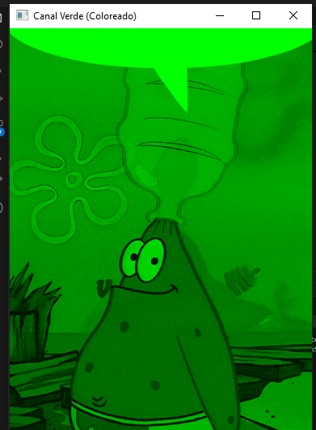
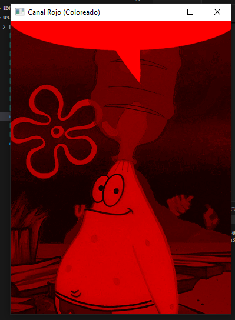

## Imagen redimensionada 
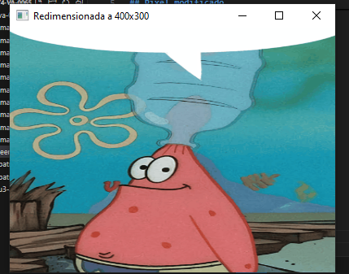
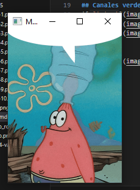
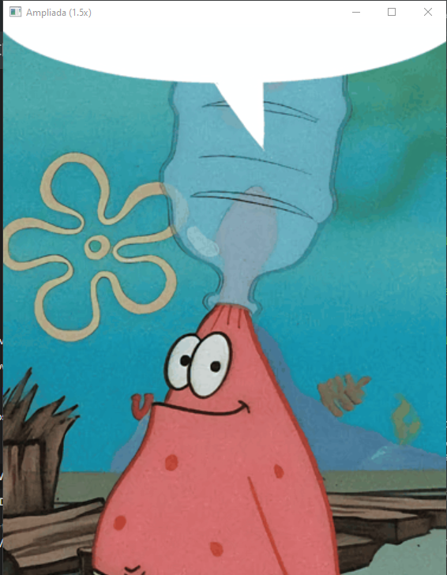

## 45 grados
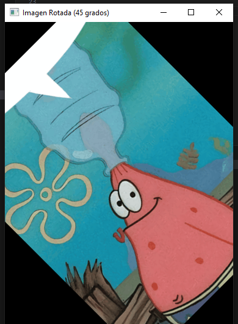

## cambio de ejes
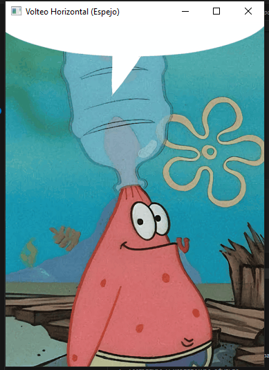
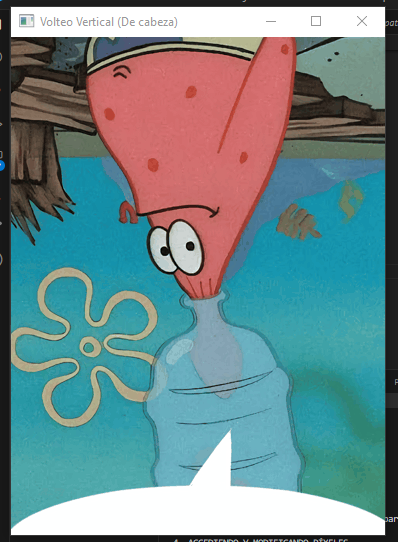
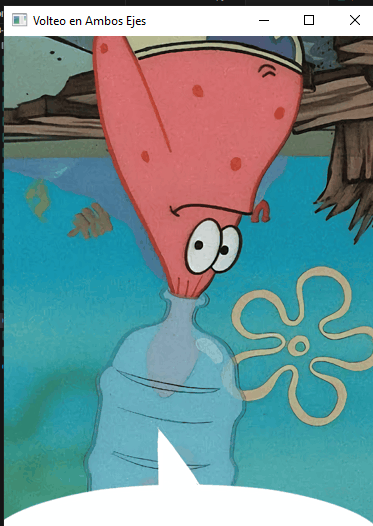